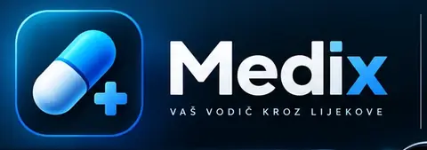

  

<h1 align="center">MediX — Know your medicines. Navigate with confidence.</h1>

  A beautifully focused medicine companion for clearer information, more organized therapy and smarter everyday decisions.

  <strong>💊 Trusted medicine records</strong> &nbsp;·&nbsp;
  <strong>🔎 Powerful discovery</strong> &nbsp;·&nbsp;
  <strong>📅 Personal therapy planner</strong> &nbsp;·&nbsp;
  <strong>🔐 Privacy first</strong>

  <a href="https://github.com/bren-wp/MediX/releases/latest"><strong>Explore MediX for Android →</strong></a>

  

## 💊 Everything important, beautifully connected

Medicines carry more than a name. MediX helps you explore the details that matter — active ingredients, strength, pharmaceutical forms, packaging, dispensing status, reimbursement information and available prices — without switching between multiple disconnected resources.

The medicine identity comes from the **official HALMED medicine catalog**. HZZO reimbursement information and separate pricing sources complement those records without replacing or inventing medicine names.

## ✨ Discover what MediX can do

| | Experience | Why you'll love it |
|---|---|---|
| 🔎 | **Medicine search** | Find products by name, ingredient, ATC classification, package and precise filters. |
| ✨ | **MediX Smart** | Explore the verified catalog using simple, structured search phrases. |
| 💊 | **Medicine profiles** | See essential product information in a clear, unified view. |
| ↔️ | **Side-by-side comparisons** | Compare up to four medicine records and their available details. |
| 🔗 | **Related medicines** | Discover records connected by their active ingredient; never assume automatic interchangeability. |
| 🛡️ | **Interaction review** | Understand what verified interaction information is available — and when a clinical answer cannot be given. |
| 🧮 | **Nine clinical calculators** | Explore BMI, BSA, CKD-EPI 2021, CHA₂DS₂-VASc, HAS-BLED, GCS, original MELD, PERC and Wells PE. |
| 🧬 | **ATC & ICD-10** | Navigate medicine and diagnostic classifications with searchable indexes. |
| 📅 | **Your therapy, your schedule** | Plan specific weekdays and reminders, and edit existing therapy entries. |
| ❤️ | **Your favorites** | Keep frequently used medicine records within easy reach. |
| 💶 | **Prices & packages** | Review available price and reimbursement information with clear distinctions between price types. |
| 🏥 | **Find pharmacies** | Continue your pharmacy search in your preferred Android maps app. |

## 📅 A calmer way to organize therapy

**Make your schedule work for you.** Add medicines, record your instructions, select the right days of the week and set reminder times. Review upcoming doses in the therapy calendar, and update your plan without starting again.

Your personal therapy information remains on your device. You do not need an account to use the core MediX experience.

## 🌍 Made for more people

- **English-first** interface with a language selector offering **24 languages**, including Croatian
- Clear, intuitive navigation designed around real medicine information
- The official names of medicines remain unchanged, preserving their identity in the source catalog
- More localized interface content is introduced progressively; where translations are unavailable, MediX uses English rather than inventing medical terminology

## 📄 Take your information with you

Your personal MediX export brings useful information into one convenient **ZIP archive** containing PDF documents:

- 📅 Your saved therapy plan and reminder schedule
- ❤️ Your favorite medicines
- ℹ️ App and privacy information

Exports are created on your device and shared through the Android share sheet. No MediX account or cloud upload is required to prepare them.

## 🔐 Privacy that respects your choices

MediX does not require a user account. It keeps favorites, therapy entries and personal preferences on your device, while Android permissions are requested for features that need them. You control when to share your exported data.

Read the [Privacy Policy](https://brendigo.com/politika-privatnosti/) and [Terms of Use](https://brendigo.com/uvjeti-koristenja/).

## 🎨 A distinctive MediX experience

Deep navy surfaces. Electric cyan accents. Readable medicine cards. Consistent controls. Carefully balanced information density. Every element is designed to make complex medicine data easier to navigate, without sacrificing clarity.

  

## 🩺 Health information, handled responsibly

MediX is an informational medicine and clinical-calculation companion. It is **not a medical device**, does not diagnose or prescribe treatment, and is not a replacement for a qualified healthcare professional. A missing interaction record must never be interpreted as confirmation that a medicine combination is safe. Always refer to the official product information and clinical advice before making treatment decisions.

---

  <strong>Designed and developed by Brendigo</strong> 
  <em>MediX — your clearer way through medicine information.</em>

